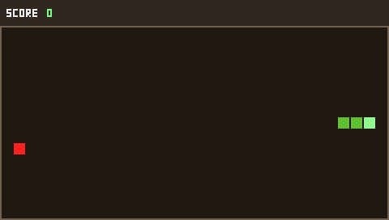
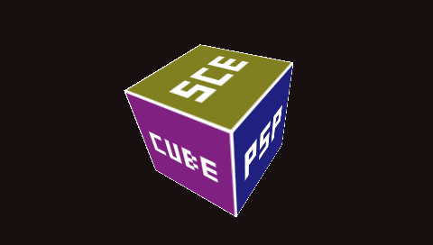
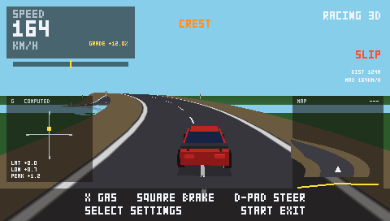
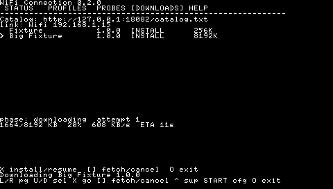
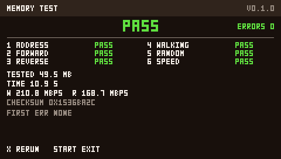
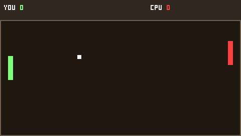

# PSP Playground

A collection of PSP homebrew targets written in **C99** with the **PSPSDK**,
rendered directly with **sceGu**. No SDL, no engine — the only external assets
are the optional 144×80 PBP menu icons.

## Targets

| Target | What it is |
|---|---|
| **Snake** | Classic 2D snake game on a 30×15 grid |
| **Cube 3D** | Rotating textured cube (`sceGu` + `pspgum`) |
| **Racing 3D** | Endless driving game with selectable maps, terrain sliders, crest jumps, HUD and minimap |
| **WiFi Connection** | Saved Wi-Fi profiles, full link status, probes, netconf, and resumable LAN downloads |
| **WiFi Test** | Low-level connect/status diagnostic |
| **Memory Test** | Start-to-end user-RAM diagnostic with PASS/FAIL |
| **Pong** | Minimal 2D game (GU load test) |
| **Screen** | Smallest `pspDebugScreen` app |
| **HelloLog** | Boot diagnostic with a log file |

All share a hand-coded 3×5 bitmap font. Snake, Cube 3D, Pong, Racing 3D and
WiFi Connection carry 144×80 PBP menu icons.

## Screenshots

| Snake | Cube 3D | Racing 3D |
|---|---|---|
|  |  |  |

| WiFi Connection | Memory Test | Pong |
|---|---|---|
|  |  |  |

## Build

Requires the [PSPSDK](https://github.com/pspdev/pspdev) toolchain.

```sh
./scripts/test.sh
./scripts/build.sh
```

`build.sh` defaults to `PSP_MEMSIZE=1` (extended ~55 MiB partition on
PSP-2000/3000/Go/Street under ARK 5.1+). Use `PSP_MEMSIZE=0` for a
PSP-1000 / universal (24 MB) build.

## Install on a real PSP

Copy the built `EBOOT.PBP` to the Memory Stick:

```
ms0:/PSP/GAME/HOMEBREW/<App>/EBOOT.PBP
```

Requires custom firmware (ARK-5 or compatible).

## How the games play

**Snake** — D-pad steers; the snake moves one cell per tick. Eating food grows
the snake and adds a point. Hitting a wall or your own body ends the round.
Speed increases every five foods. Cross restarts after game over; START exits.

**Cube 3D** — A 1.6-unit cube rotating around X, Y and Z, with six 64×64
textures generated at runtime. START exits.

**Racing 3D** — A third-person endless driving game. The welcome screen selects
`DEFAULT`, `UPHILL` or `HIGHWAY` and four terrain sliders. D-pad steers (or the
calibrated analog nub in analog mode), Cross accelerates, Square brakes (tap for
a grip boost), Select opens the pausing menu, Start exits when the menu is
closed and resumes when it is open. Settings persist in
`ms0:/PSP/SAVEDATA/RACING3D/RACING.CFG`.

**Pong** — D-pad moves the left paddle; the CPU follows the ball. Cross
starts/reruns; START exits.

**Memory Test** — Runs a start-to-end user-RAM test and reports PASS/FAIL, the
first bad address and MB/s. Cross starts/reruns; START aborts cleanly.

**WiFi Connection** — Saved-profile picker (slots 1..16), full link status,
DNS/TCP/gateway/HTTP probes, modal `sceUtilityNetconf`, reconnect supervisor and
a DOWNLOADS page. Up/Down select, Cross installs/resumes, Square fetches the
catalog or cancels, Circle exits.

## License

MIT — see [LICENSE](LICENSE).
