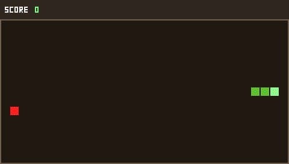
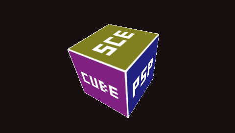
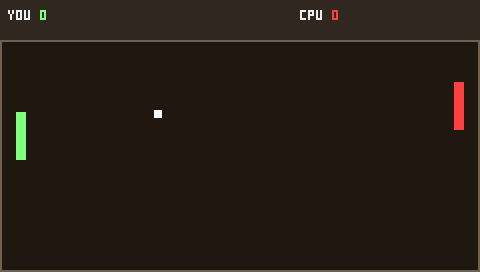
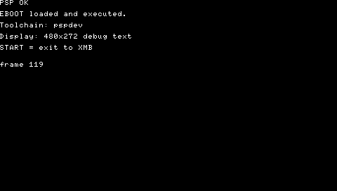
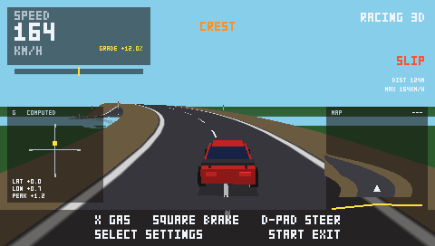
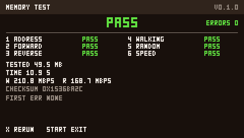
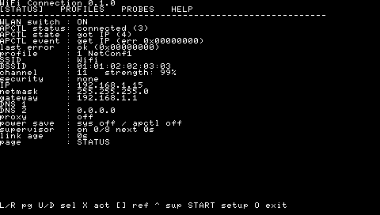

# Headless testing with PPSSPPHeadless

This container has no display. `PPSSPPHeadless` runs the PSP emulator with the
**software GPU**, no SDL and no X11, and saves screenshots + frame stats. It is
the right tool for correctness and visual checks; it is **not** a PSP
performance measurement.

## Build (once)

The binary used here is built from PPSSPP master at:

```text
/home/agent/ppsspp/build/PPSSPPHeadless
```

Build recipe (Linux x86-64, tested with GCC 14 and CMake 3.31):

```sh
sudo apt-get install -y ninja-build libglew-dev libgl1-mesa-dev \
  libglu1-mesa-dev libegl1-mesa-dev libgles2-mesa-dev libgles-dev \
  libx11-dev libxext-dev libxrandr-dev libxi-dev libpng-dev libzstd-dev

git clone --depth 1 --recurse-submodules --shallow-submodules \
  https://github.com/hrydgard/ppsspp.git ~/ppsspp/src

cmake -S ~/ppsspp/src -B ~/ppsspp/build -G Ninja \
  -DCMAKE_BUILD_TYPE=Release \
  -DHEADLESS=ON -DHEADLESS_CROSS=ON \
  -DUSE_DISCORD=OFF -DUSE_MINIUPNPC=OFF \
  -DVULKAN=OFF -DUSING_X11_VULKAN=OFF -DUSE_WAYLAND_WSI=OFF \
  -DUSE_SYSTEM_LIBPNG=OFF -DUSE_SYSTEM_ZSTD=OFF \
  -DCMAKE_CXX_STANDARD_LIBRARIES="-lGL"

cmake --build ~/ppsspp/build --target PPSSPPHeadless -j3
```

The `-DCMAKE_CXX_STANDARD_LIBRARIES="-lGL"` is required on Debian 13:
the default link line pulls `libOpenGL`/`libGLX`/`libGLEW` but not `libGL`,
which leaves `glGetFloatv` undefined (`DSO missing from command line`).

`HEADLESS_CROSS=ON` removes SDL; only `--graphics=software` works.

## Run the suite

```sh
./scripts/test-ppsspp.sh
```

Outputs (one directory per app):

```text
build/ppsspp/<app>/EBOOT.PBP
build/ppsspp/<app>/screen.png
build/ppsspp/<app>/run.log
```

The screenshot suite covers `screen`, `pong`, `snake`, `cube3d`, `memtest`,
`racing` and `wifi`. `wifi-test` is built but is not part of this screenshot run.
The graphical targets must exceed 5% non-black pixels with at least four
distinct colours; `screen` uses 0.5%/2 and the text-only `wifi` uses 1%/2
because `pspDebugScreen` is mostly black text. The script prints `PASS` when
every target meets its threshold.

Override the binary or output directory:

```sh
PPSSPP_HEADLESS=/path/to/PPSSPPHeadless ./scripts/test-ppsspp.sh /tmp/psp-out
```

## Racing 3D road-coverage probe

`scripts/check-racing-road.py` is the regression check for the 0.2.1
grass-through-road fix. It runs the Racing 3D EBOOT once with Cross held for
60 s, captures 29 frames (4, 6, …, 60 s) and fails if any ground-coloured
pixel has an asphalt fraction ≥ 80 % in a 17×17 window, or if a frame shows
fewer than 5000 asphalt pixels (the road must be on screen).

```sh
./scripts/build.sh
./scripts/check-racing-road.py
```

Output is one `time asphalt_px hits` line per frame and a final `PASS`/`FAIL`
(exit 0/1; 2 for tool errors, including an unreadable capture). Measured on
the pre-fix renderer with the 0.2.1 physics: 281 hit pixels on 7 of 29 frames.
After the fix: 0.

The probe holds Cross on the fixed-seed road, so it samples a deterministic
line. If the physics or road changes that line, re-confirm the probe can still
fail by temporarily reverting the depth-less ground draw (the measured red
state is 281 hits on 7 frames); a check that cannot fail is worthless.

A diagnostic build paints the ground magenta (`RGB(0xFF,0x00,0xFF)`) so the
probe can find any ground pixel over the asphalt unambiguously:

```sh
export PSPDEV="${PSPDEV:-$HOME/pspdev}"; export PATH="$PATH:$PSPDEV/bin"
psp-cmake -S . -B build/psp-diag -DCMAKE_BUILD_TYPE=Release \
    -DPSP_MEMSIZE=1 -DRACING_DIAG_GROUND=ON
cmake --build build/psp-diag --target psp_racing
./scripts/check-racing-road.py \
    --eboot build/psp-diag/racing/EBOOT.PBP --magenta
```

`RACING_DIAG_GROUND` defaults to OFF, so a normal build is unchanged. Use
`--times 4,10,32` for a quick run and `--out DIR`/`--keep` to inspect the
captures. The probe needs the same dependencies as the suite (pspdev build +
`PPSSPPHeadless`).

The 0.3.0 HUD adds a G-meter and a minimap that paints asphalt-coloured
pixels on the HUD. `check-racing-road.py` excludes the fixed panel rectangles
`(8,74,166,104)`, `(8,116,116,226)`, `(358,116,474,226)` and the DIST/MAX
text footprint `(420,84,472,102)` from both scans. The red-state check with
these rectangles still finds the 0.2.1 grass-through-road defect (measured
217 hits on 6/29 frames after the HUD was added; 281/7 before).

## Racing 3D 0.3.0 HUD/pause/persistence probe

`scripts/check-racing-030.py` covers the 0.3.0 features in seven headless
runs. Every press script starts with `0.1:Cross:0.2` so the welcome-first
0.4.0 EBOOT enters the game; the 0.3.0 base treats it as throttle.

1. **HUD:** at 2.5 s, the G-meter panel (plus its `COMPUTED` and numeric text),
   minimap panel (plus its `MAP` title), steering-bar accent tick and
   DIST/MAX text are present.
2. **Pause:** hold Cross from 0.5 s for 2 s, open Select at 2.55 s, capture at
   3.7 s and 4.7 s; the two frames must differ by ≤16 pixels (the game is
   paused and the camera is frozen with `dt=0`).
3. **Save:** Select, Down, Right, Select writes sensitivity 1.1
   (`RACING.CFG` byte 6 = 110, flags 7).
4. **Load + save:** a second run loads 1.1 and Right writes 1.2 (byte 6 =
   120).
5. **Corrupt:** XOR one bit into byte 6; the CRC fails, the game loads
   defaults, and Right writes 1.1 (byte 6 = 110) — not 131.
6. **Calibration:** Select, five Downs and Cross reach the calibration
   screen and draw the raw values.
7. **Off-road marker:** Cross + Right puts the car on the shoulder; the
   minimap car marker is orange (`COL_HUD_WARN`) and the HUD shows
   `OFF ROAD`; the straight-road control has no orange marker.

```sh
./scripts/check-racing-030.py
# or: --out DIR / --keep / --eboot PATH
```

Two PPSSPPHeadless details matter:

- `--press` takes **one comma-separated script**:
  `--press=0.5:0x1:0.1,0.9:0x40:0.1,...`. Repeating `--press` replaces the
  previous script instead of appending to it.
- `--root` only mounts `host0:`; the probe also passes `--memstick=<root>`
  so `ms0:/PSP/SAVEDATA/RACING3D/RACING.CFG` lands inside the probe root and
  can be parsed.

PPSSPP cannot inject analog-nub values, so the calibration *mapping* is
covered by the host tests (`test_analog_mapping_calibrated`) and the
real-PSP checklist; the headless probe only proves the calibration screen
renders. The probe covers the missing-file run (fresh root → defaults),
save→load→save and corrupt→defaults; a missing/read-only ms0 is manual on
hardware. No host shim is added for the PSP I/O layer.

## Racing 3D 0.5.0 Maps probes

`scripts/check-racing-050.py --section all` runs the 0.5.0 checks. It uses
the release EBOOT for render/HUD/welcome/maps/lanes and the test-only
`RACING_DIAG_CREST`/`RACING_DIAG_NARROW` EBOOTs for the AIR and one-lane
captures.

- **render:** on the release EBOOT, holds Cross for 12 s, captures 2/4/6/8/
  10/12 s, requires asphalt in every frame and no sky in the lower ground
  band; a 24 s release run counts the amber narrow-section posts, and the
  one-lane diagnostic supplies the `NARROW` text check.
- **hud:** a 0.1 s Square tap flashes `GRIP`; a 0.3 s hold does not. The
  release run shows `CREST` and `GRADE`; the one-lane diagnostic shows
  `NARROW`; the diagnostic crest EBOOT shows `AIR`; the minimap panel and
  elevation profile are present.
- **welcome:** the `MAP` row is above `START GAME`; Down/Right grows the
  elevation bar; Cross starts; `RESTART` returns with the chosen value; a
  fresh launch returns to the DEFAULT/100 % defaults; a second START after
  `RESTART` must produce a different gameplay frame at the same elapsed time
  (`seed_diff >= 500`), proving a new session seed.
- **maps:** the MAP row cycles DEFAULT/UPHILL/HIGHWAY; HIGHWAY grays and
  ignores the WIDTH/ONE LANE rows; HIGHWAY and UPHILL gameplay HUDs are
  present; `RESTART` keeps HIGHWAY. The committed `MAP_MEASURED` counts are
  1541/1478/1533 (DEFAULT/HIGHWAY/UPHILL).
- **lanes:** the one-lane diagnostic has 0 centre-stripe pixels, 2 scanline
  clusters (edge lines only) and 150 amber pixels; DEFAULT has 3 clusters,
  HIGHWAY 5. The committed `LANE_MEASURED` counts are 70 base centre, 32
  DEFAULT centre, 0 one-lane centre, 3/3/2/5 clusters and 1543/1477 ROI.
  A moving capture at 2.4–2.8 s with Cross held compares the interior
  dash mask (x 220–260, y 130–205, static edge lines excluded) on
  consecutive 0.1 s frames and requires at least 5 changed pixels each time
  (`moving_min_change >= 5`; measured 24), so a car-anchored pattern that
  only toggles in place fails.

Build both diagnostic EBOOTs and run:

```sh
export PSPDEV="${PSPDEV:-$HOME/pspdev}"; export PATH="$PATH:$PSPDEV/bin"
psp-cmake -S . -B build/psp-diag-crest -DCMAKE_BUILD_TYPE=Release \
    -DPSP_MEMSIZE=1 -DRACING_DIAG_CREST=ON
cmake --build build/psp-diag-crest --target psp_racing
psp-cmake -S . -B build/psp-diag-narrow -DCMAKE_BUILD_TYPE=Release \
    -DPSP_MEMSIZE=1 -DRACING_DIAG_NARROW=ON
cmake --build build/psp-diag-narrow --target psp_racing
./scripts/check-racing-050.py --section all \
    --air-eboot build/psp-diag-crest/racing/EBOOT.PBP \
    --lane-eboot build/psp-diag-narrow/racing/EBOOT.PBP
python3 scripts/check-racing-050-docs.py
```

The lane base red proof is optional and needs a separate 0.4.0 EBOOT; the
normal gate runs without it. To run the red proof, build/copy a 0.4.0 EBOOT
and add `--base-eboot /tmp/opencode/racing-040-base.EBOOT.PBP`; the probe
prints `base_centre`/`base_clusters` and asserts the 0.4.0 centre stripe is
visible. Without the option it skips the red proof with a warning.

The diagnostic builds are test-only and must not be published. The updated
`scripts/check-racing-030.py` remains the 0.3.0 HUD/pause/persistence/
calibration regression probe.

## Manual invocation

```sh
cd ~/ppsspp/build
./PPSSPPHeadless /path/to/EBOOT.PBP \
  --graphics=software \
  --root=/path/to/folder-with-eboot \
  --timeout-emulated=6 \
  --timeout-wall=60 \
  --frame-stats \
  --screenshot-save=/tmp/screen.png \
  -l
```

Useful options:

| Option | Meaning |
|---|---|
| `--timeout-emulated=N` | stop after N emulated seconds |
| `--timeout-wall=N` | hard wall-clock guard |
| `--frame-stats` | flips per emulated second (emulator only) |
| `--screenshot-save=FILE` | save the last displayed frame |
| `--screenshot-at=SEC:FILE` | save a frame at a specific emulated time |
| `--root=DIR` | make DIR the root of `host0:` |
| `--graphics=software` | required for the headless build |

## Caveats

- **Emulated FPS is not PSP FPS.** The software renderer does not model the
  GE fill cost, CPU caches or real bus contention. Use real hardware (PSPLINK)
  for performance claims.
- The screenshot is the emulator's framebuffer; in our builds it is 512 px
  wide because the PSP stride is 512 for a 480-wide display. The docs images
  are cropped to 480×272.
- No audio is tested here; none of the current targets has audio.
- The headless binary is built outside the repository (~780 MB of source +
  ~25 MB binary). It is not committed.

## Captured frames

| Snake | Cube 3D |
|---|---|
|  |  |
| **Pong** | **Screen** |
|  |  |
| **Racing 3D** | **Memory Test** |
|  |  |
| **WiFi Connection** |  |
|  |  |

The raw captures are 512×272 (PSP stride 512 for a 480-wide display); the
images under `docs/screenshots/` are cropped to 480×272.

## WiFi Connection 0.2.0 DOWNLOADS probes

Four probes cover the downloader:

```sh
./scripts/test-download-http.sh    # host engine vs the mock HTTP server
./scripts/test-download-ppsspp.sh  # real PSP socket/storage path vs mock
python3 scripts/check-wifi-020.py          # STATUS -> DOWNLOADS -> catalog page
python3 scripts/check-wifi-020-progress.py # catalog row + live progress
```

`test-download-http.sh` starts `scripts/mock-catalog-server.py` on
`127.0.0.1:18080` and prints `PASS` for fresh 200, cut+resume, ETag change,
416, chunked/gzip rejection, checksum mismatch and two cuts.

`test-download-ppsspp.sh` runs the `wifi-test` diagnostic EBOOT with
`--root`/`--memstick` and a `WIFI_DL_TEST.TXT` job; it asserts the real
`result=OK`/bytes/SHA-256/attempts, the `cancel` scenario keeps a `.part` +
`.resume`, `stall` cancels a stalled read within ~2 s, 416 returns
`RANGE_REJECTED`, and `slow` (4 KiB / 0.2 s over `/apps/EBOOT.PBP`, run with
`--realtime`) finishes with `result=OK` and the full 262144 bytes. The
realtime flag is required: the mock server sleeps in wall time while PPSSPP
otherwise advances emulated time much faster, which would make the transfer
look stalled.

`check-wifi-020.py` captures STATUS, three Rights later DOWNLOADS, and a
Cross-triggered catalog fetch; it asserts non-blank pages and structural pixel
differences (no OCR). `check-wifi-020-progress.py` selects the 8 MiB
`Big Fixture` row (`/apps/big/EBOOT.PBP`, 64 KiB / 0.1 s, `--realtime`),
asserts the server received the app GET, watches `.part` grow to several
distinct sizes, and requires the progress rows (y=160..192) to differ between
two mid-transfer captures. An identical progress frame compares as 0.00 % and
fails the 0.05 % gate. The docs screenshot is the 480×272 crop of the first
mid-transfer capture.

PPSSPP fakes APCTL and proxies host sockets. Suspend/resume, the WLAN switch,
backlight and CPU clock still need the real-PSP checklist in
[`WIFI.md`](WIFI.md) §15.5.
