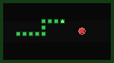
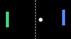
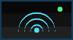

# App icons (PBP `ICON0.PNG`)

PSP games show a small icon in the XMB (Game → Memory Stick). The icon lives
inside `EBOOT.PBP` as section `ICON0.PNG`; it is not a separate file on the
Memory Stick.

## Current icons

| App | Icon | Source |
|---|---|---|
| Snake |  | `assets/icon_snake.png` |
| Cube 3D |  | `assets/icon_cube3d.png` |
| Pong |  | `assets/icon_pong.png` |
| Racing 3D |  | `assets/icon_racing.png` |
| WiFi Connection |  | `assets/icon_wifi.png` |

These targets still build with `ICON_PATH NULL` (no icon):

- Memory Test (`memtest/`)
- WiFi Test (`wifi-test/`)
- Screen (`screen/`)
- HelloLog (`hello/`) and the official `basic/*` samples

## Format

- **144 × 80 pixels**, PNG, 8-bit RGB or RGBA.
- Keep it small; the whole image is embedded in every EBOOT.
- The `create_pbp_file` comment in pspdev says “144x82”, but the PSP
  `ICON0.PNG` format is **144×80**. Use 144×80.

## CMake wiring

`create_pbp_file` accepts an absolute `ICON_PATH`:

```cmake
create_pbp_file(
    TARGET psp_snake
    ICON_PATH ${CMAKE_SOURCE_DIR}/assets/icon_snake.png
    BACKGROUND_PATH NULL
    PREVIEW_PATH NULL
    TITLE "Snake"
    VERSION ${PSP_VERSION}
    MEMSIZE ${PSP_MEMSIZE}
)
```

The same pattern is used in `cube3d/CMakeLists.txt`, `pong/CMakeLists.txt`,
`racing/CMakeLists.txt` and `wifi/CMakeLists.txt`.

Commit the PNG **together** with the CMake change. If `assets/` is missing on
a fresh clone, CMake configuration or `pack-pbp` will fail.

## Generating the icons

`scripts/gen_icons.py` is a dependency-free generator (pure Python `zlib` +
`struct`, no Pillow). It draws the current icons into `assets/`:

```sh
python3 scripts/gen_icons.py
```

Edit the `make_snake()`, `make_cube()`, `make_racing()`, or `make_pong()`
functions and re-run it. The generator always writes 144×80 RGB PNGs.

## Build and verify

`./scripts/build.sh` replaces `ICON_PATH NULL` with the PNG path; `pack-pbp`
embeds the image as section 1 of the PBP. A quick check that the icon really
made it into an EBOOT:

```sh
python3 - <<'PY'
import struct
b = open('build/psp/racing/EBOOT.PBP', 'rb').read()
o = struct.unpack('<8I', b[8:40])
icon = b[o[1]:o[2]]
print(len(icon), 'bytes, PNG:', icon[:8] == b'\x89PNG\r\n\x1a\n')
PY
```

The EBOOT grows by roughly the PNG size (hundreds of bytes for these icons).

## Real-PSP check

The icons have been verified in the built EBOOTs, but not yet visually in the
PSP-2000 XMB. After copying the new EBOOT to the Memory Stick, confirm the
icon appears next to the game. If it does not:

1. Confirm the PNG is exactly 144×80.
2. Confirm `ICON_PATH` points at an existing absolute path.
3. Rebuild the EBOOT (`./scripts/build.sh`) and copy the **new** `EBOOT.PBP`.
4. Check that the PBP section 1 is a PNG (snippet above).

## Publishing caveat

The current published builds are **Racing 3D 0.5.0** (real-PSP validation
pending) and **WiFi Connection 0.2.0** (newly published 2026-11-09; real-PSP
validation pending), and both have their 144×80 icons embedded (verified in
the remote PBP section 1). **WiFi Connection 0.1.0** (hardware-validated
fallback, 167,315 B), **Memory Test 0.1.0** (no icon) and Racing 3D 0.4.0
(the hardware-validated racing fallback), Racing 3D 0.3.0, Snake 0.1.3, Cube
3D 0.1.4 and Pong 0.1.1 are archived in `PSP_OLD/`, not current; they carry
icons where noted.

Icons are embedded in the EBOOT, so any icon change changes the EBOOT
size/SHA-256 and is a real rebuild for publishing. See
`docs/EBOOT-BACKUPS.md` for the current set.
