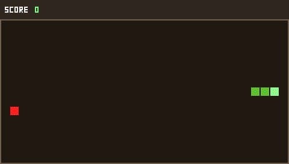
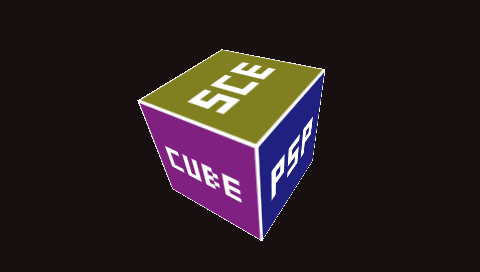
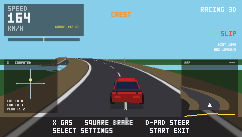
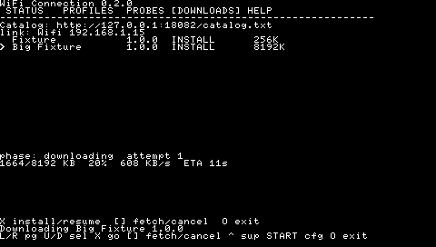
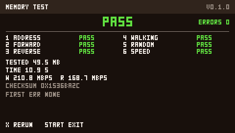
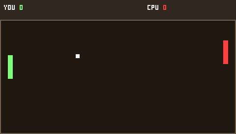

# PSP Playground

A collection of PSP homebrew targets written in **C99** with the **PSPSDK**,
rendered directly with **sceGu**.

## Targets

- **Snake** — classic 2D game
- **Cube 3D** — rotating textured cube
- **Racing 3D** — endless driving game with selectable road maps
- **WiFi Connection** — saved profiles, link status, probes, and resumable downloads
- **WiFi Test** — low-level connect/status diagnostic
- **Memory Test** — user-RAM diagnostic
- **Pong** — minimal 2D game
- **Screen** — smallest `pspDebugScreen` app
- **HelloLog** — boot diagnostic with log file

## Screenshots

| Snake | Cube 3D | Racing 3D |
|---|---|---|
|  |  |  |

| WiFi Connection | Memory Test | Pong |
|---|---|---|
|  |  |  |

## Downloads (v0.5.0)

Pre-built EBOOTs from the latest [GitHub Release](https://github.com/konqiDAM/psp-playground/releases/tag/v0.5.0).
Copy each to `ms0:/PSP/GAME/HOMEBREW/<App>/EBOOT.PBP` on your Memory Stick.

| App | Download |
|---|---|
| Snake | [snake-EBOOT.PBP](https://github.com/konqiDAM/psp-playground/releases/download/v0.5.0/snake-EBOOT.PBP) |
| Cube 3D | [cube3d-EBOOT.PBP](https://github.com/konqiDAM/psp-playground/releases/download/v0.5.0/cube3d-EBOOT.PBP) |
| Racing 3D | [racing-EBOOT.PBP](https://github.com/konqiDAM/psp-playground/releases/download/v0.5.0/racing-EBOOT.PBP) |
| Memory Test | [memtest-EBOOT.PBP](https://github.com/konqiDAM/psp-playground/releases/download/v0.5.0/memtest-EBOOT.PBP) |
| Screen | [screen-EBOOT.PBP](https://github.com/konqiDAM/psp-playground/releases/download/v0.5.0/screen-EBOOT.PBP) |
| Pong | [pong-EBOOT.PBP](https://github.com/konqiDAM/psp-playground/releases/download/v0.5.0/pong-EBOOT.PBP) |
| WiFi Test | [wifi-test-EBOOT.PBP](https://github.com/konqiDAM/psp-playground/releases/download/v0.5.0/wifi-test-EBOOT.PBP) |
| WiFi Connection | [wifi-EBOOT.PBP](https://github.com/konqiDAM/psp-playground/releases/download/v0.5.0/wifi-EBOOT.PBP) |

> **Note:** These are HTTPS links for downloading on a PC/phone. The PSP's
> WiFi Connection downloader uses a separate LAN HTTP server (see the
> [development guide](PSP-DEV-GUIDE.md)).

## Documentation

- [Development guide](PSP-DEV-GUIDE.md) — build rules, pitfalls, MEMSIZE policy
- [Icons](ICONS.md) — PBP menu icon format and workflow
- [Headless testing](HEADLESS-TESTING.md) — PPSSPP render checks
- [Build pipeline](PIPELINE.md) — multi-agent workflow

## Source

[github.com/konqiDAM/psp-playground](https://github.com/konqiDAM/psp-playground)